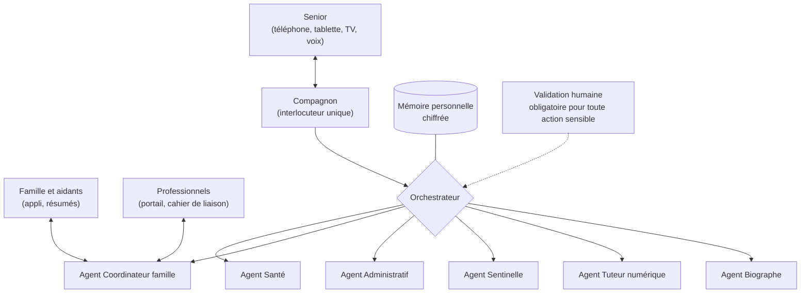

# 3. L'IA et les agents : une équipe invisible au service de la famille

Le service étant payant, on peut investir dans une IA de très haut niveau.
L'idée n'est pas d'avoir « un chatbot », mais une **équipe d'agents
spécialisés**, coordonnés, qui travaillent en coulisses pour le senior et sa
famille. Pour le senior, il n'y a qu'**un seul interlocuteur** : son
compagnon, avec un prénom et une voix qu'il a choisis.

## L'architecture des agents

| Agent | Rôle | Exemples | Limites strictes |
|---|---|---|---|
| **Compagnon** | L'interlocuteur unique du senior. Conversation naturelle, mémoire des prénoms, des goûts, de l'histoire de vie. | Appel du matin, lecture des messages de la famille, discussion sur le match d'hier. | Dit toujours qu'il est une IA. Ne se fait jamais passer pour un proche. |
| **Santé** | Médicaments, rendez-vous, journal des symptômes, bien-être. | Rappels, escalade, fiche de préparation de consultation. | **Jamais de diagnostic, jamais de modification de traitement.** Toute ordonnance scannée est validée par un humain. |
| **Coordinateur famille** | Synthèses, répartition des tâches, rappels de présence. | Résumé du dimanche, « Qui accompagne mamie jeudi ? ». | Ne partage que ce que le senior a autorisé. |
| **Administratif** | Lecture des courriers, aide aux démarches, échéances. | « Ce courrier de la CAF demande une réponse avant le 12. » | Prépare, n'envoie jamais rien sans validation. Aucun paiement autonome. |
| **Sentinelle** | Sécurité : check-in quotidien, routines, anti-arnaque, alertes météo. | Cascade d'alerte si pas de « bonjour », analyse d'un SMS suspect. | Seuils et destinataires des alertes fixés par la famille et le senior. |
| **Tuteur numérique** | Apprentissage, guidage pas à pas, lecture d'écran. | « Appuyez sur le rond vert en bas à droite. » | Ne saisit jamais un mot de passe ou un code bancaire à la place du senior. |
| **Biographe** | Recueil de souvenirs, livre de vie, arbre généalogique. | Questions au fil des conversations, montage du livre annuel. | Le senior relit et choisit ce qui est partagé. |

## Les règles d'or de l'IA chez PPS

1. **Transparence** : l'IA dit qu'elle est une IA, à chaque fois que c'est
   utile, et en particulier au début de chaque appel. C'est aussi une
   obligation du règlement européen sur l'IA (AI Act).
2. **L'humain dans la boucle** : aucune action irréversible ou sensible
   (envoi d'un document, paiement, partage d'une donnée de santé, changement
   de planning de traitement) sans validation humaine.
3. **Pousser vers l'humain** : la réussite de l'IA se mesure au nombre de
   contacts humains qu'elle provoque. Elle propose d'appeler un proche,
   relaie les nouvelles, rappelle les anniversaires. Elle évite toute
   dépendance émotionnelle.
4. **Pas de clonage de voix de proches** pour parler au senior. C'est une
   ligne rouge : confusion, manipulation, et c'est exactement la technique
   des arnaqueurs.
5. **Pas de manipulation, pas de publicité** : l'IA ne vend rien, ne pousse à
   aucun achat, ne cherche pas à maximiser le temps d'utilisation.
6. **Respect du refus** : « Je n'ai pas envie de parler aujourd'hui » est une
   réponse valable. L'IA s'adapte, sans culpabiliser.
7. **Escalade en cas de doute** : douleur thoracique, propos suicidaires,
   chute, confusion inhabituelle → protocole clair (proche, téléassistance,
   15 ou 112), défini avec des professionnels de santé.
8. **Explicabilité pour la famille** : chaque alerte dit pourquoi elle a été
   déclenchée (« Pas de réponse à l'appel de 9h, ni à celui de 9h30 »).

## Les briques technologiques

| Brique | Usage | Points d'attention |
|---|---|---|
| **Grand modèle de langage (LLM)** | Conversation, compréhension, synthèse, rédaction | Architecture multi-fournisseurs (par exemple Anthropic Claude, Mistral), hébergement ou traitement en Europe, pas d'entraînement sur les données des utilisateurs. |
| **Reconnaissance vocale (STT)** | Comprendre le senior | À tester sur des voix âgées : débit lent, voix tremblante, accents régionaux, appareils dentaires. Un vrai sujet de qualité. |
| **Synthèse vocale (TTS)** | Faire parler le compagnon | Voix chaleureuse, naturelle, débit réglable, pas de voix « robot ». |
| **Voix temps réel** | Appels téléphoniques fluides | Latence faible, gestion des interruptions et des silences longs. |
| **Téléphonie** | Appels sortants et entrants sur fixe ou mobile | Opérateur ou plateforme de téléphonie programmable, numéros français. |
| **Vision** | Lire une ordonnance, un courrier, un écran, une boîte de médicament | Toujours avec confirmation humaine pour la santé. |
| **Mémoire personnelle** | Se souvenir de la personne, de sa famille, de son histoire | Stockage chiffré, consultable et effaçable par le senior. |
| **Garde-fous** | Filtrage des sujets à risque, détection d'urgence | Tests réguliers et scénarios rédigés avec des gériatres. |

## Évaluer l'IA sérieusement

Parce que les utilisateurs sont vulnérables, la qualité de l'IA doit être
mesurée en continu :

- **Jeux de tests** de conversations réelles (anonymisées et consenties) :
  urgences, confusions, arnaques, questions médicales.
- **Évaluation par des professionnels** (gériatres, infirmières, psychologues)
  sur un échantillon de conversations.
- **Indicateurs suivis** : taux de compréhension de la parole, fausses
  alertes, alertes manquées, satisfaction du senior, nombre de contacts
  humains générés.
- **Panel de seniors testeurs** rémunérés, impliqués dès le début.
