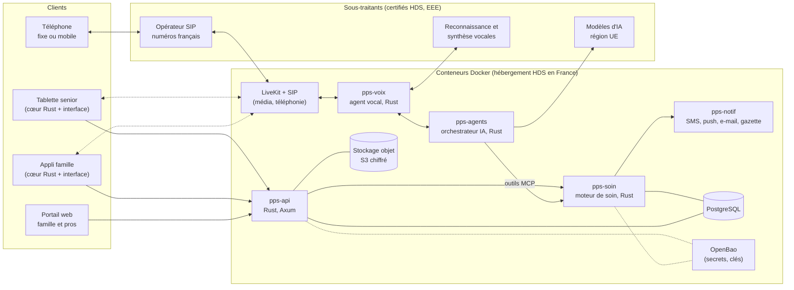

# 6. Architecture technique : Rust, Docker, PostgreSQL

> Le principe des **deux étages** (un moteur de soin sans IA, fiable et supervisé,
> et des agents IA qui proposent sans jamais décider seuls) est détaillé dans
> le [document 8](08-faisabilite-et-choix-ia.md). Ce document décrit
> comment le construire.

## Les trois décisions structurantes

| Décision | Choix | Pourquoi |
|---|---|---|
| **Langage** | **Rust** pour tout le code serveur, et pour le cœur partagé des applications | Sécurité mémoire garantie par le compilateur, performances, faible consommation de ressources, typage fort pour rendre les erreurs métier impossibles |
| **Déploiement** | **Docker** : chaque service dans son conteneur, images minimales et durcies | Environnements identiques du poste du développeur à la production, isolation des services, déploiement reproductible chez un hébergeur HDS |
| **Base de données** | **PostgreSQL** | Robuste, éprouvé dans la santé, et ses extensions couvrent tous nos besoins (voir plus bas) : c'est le meilleur choix pour PPS |

**Règle générale** : tout notre code serveur et le cœur des applications
sont en Rust. Les interfaces mobiles (V2) seront en Flutter, sans logique
métier. Les composants d'infrastructure éprouvés, écrits dans d'autres
langages (PostgreSQL en C, LiveKit en Go), sont utilisés tels quels, chacun
dans son conteneur isolé.

## Pourquoi Rust est un bon choix pour PPS

### Les atouts

- **Sécurité mémoire** : les débordements de tampon, les accès à de la mémoire
  libérée ou les accès concurrents non protégés sont **refusés à la
  compilation**. Ce sont historiquement la majorité des failles graves des
  logiciels écrits en C et C++.
- **Rendre les erreurs métier impossibles** : le système de types permet
  d'encoder nos règles de sécurité. Par exemple, le moteur de rappels peut
  être écrit pour **refuser à la compilation** un planning de médicaments qui
  n'a pas été validé par un humain (voir l'exemple ci-dessous).
- **Performances et sobriété** : des services rapides qui consomment peu de
  mémoire, donc moins de serveurs, moins de coûts d'hébergement HDS, et un
  meilleur bilan énergétique.
- **Fiabilité** : pas de ramasse-miettes, pas de pause imprévisible, une
  gestion des erreurs explicite (`Result`). Idéal pour un moteur d'alertes.
- **Un référentiel français** : l'ANSSI publie un guide de
  [règles de programmation pour le développement d'applications sécurisées en Rust](https://cyber.gouv.fr/sites/default/files/2020/06/anssi-guide-regles_de_programmation_pour_le_developpement_dapplications_securisees_en_rust-v1.0.pdf),
  que nous adopterons comme règles de codage.

### Exemple : « l'IA propose, l'humain valide », garanti par le compilateur

```rust
use jiff::Timestamp;

/// Planning de traitement proposé (lu sur une ordonnance par l'IA,
/// ou saisi par un proche). Il ne peut déclencher aucun rappel.
pub struct PlanningPropose {
    pub prises: Vec<Prise>,
    pub source: SourcePlanning,
}

/// Preuve qu'un humain habilité, récemment authentifié, a validé
/// **ce** planning précis (son empreinte). Ses champs sont privés :
/// seul le module d'authentification peut en fabriquer une, jamais un agent IA.
pub struct ValidationHumaine {
    valide_par: IdUtilisateur,
    role: RoleValidation, // organisateur, pharmacien, infirmière
    empreinte_planning: Empreinte,
    horodatage: Timestamp,
}

/// Planning validé : le seul type accepté par le moteur de rappels.
pub struct PlanningValide {
    prises: Vec<Prise>,
    validation: ValidationHumaine,
}

impl PlanningPropose {
    /// Refuse une validation donnée pour un autre planning
    /// (ou pour une version modifiée depuis).
    pub fn valider(self, validation: ValidationHumaine) -> Result<PlanningValide, ErreurSoin> {
        if validation.empreinte_planning != self.empreinte() {
            return Err(ErreurSoin::ValidationNonConcordante);
        }
        Ok(PlanningValide { prises: self.prises, validation })
    }
}

/// Appeler cette fonction avec un planning non validé ne compile pas.
pub fn programmer_rappels(planning: &PlanningValide) -> Result<(), ErreurSoin> {
    todo!("créer les workflows de rappel pour chaque prise")
}
```

### Les limites, et comment les gérer

| Limite | Parade |
|---|---|
| Démarrage plus lent qu'en Python ou TypeScript | Un socle technique soigné dès le début (modèles de services, outillage), puis une vitesse comparable |
| Recrutement plus difficile | Communauté en forte croissance, profils motivés par la sécurité. Former une partie de l'équipe. |
| Écosystème IA et voix moins fourni qu'en Python | Les briques essentielles existent (voir le tableau des bibliothèques). Pour la voix temps réel, il faut construire une partie nous-mêmes (voir plus bas). |
| Pas de SDK officiel Anthropic en Rust | Appel de Claude via le **SDK AWS pour Rust** (Amazon Bedrock, région européenne) ou par l'API HTTP, derrière une interface commune à tous les fournisseurs |
| Temps de compilation | Cache de compilation (cargo-chef dans Docker, sccache en intégration continue) |

**Règles de codage :** `unsafe` interdit dans notre code
(`unsafe_code = "forbid"`), Clippy en mode strict, et audit des dépendances
à chaque modification (voir la section Docker). Seule exception prévue : le
crate de liaison avec les applications mobiles (V2), dont le code `unsafe`
est généré par l'outil de liaison ; il sera isolé, en `deny` plutôt qu'en
`forbid`, avec revue obligatoire.

## PostgreSQL : est-ce le meilleur choix ? Oui

Nous avons comparé PostgreSQL aux alternatives. Pour PPS, **PostgreSQL est le
meilleur choix**, car ses fonctionnalités et extensions couvrent tous nos
besoins dans **une seule base** : moins de surface d'attaque, une seule
sauvegarde, une seule chose à certifier.

### Nos besoins, et la réponse de PostgreSQL

| Besoin | Réponse de PostgreSQL |
|---|---|
| Cercles familiaux, rôles, consentements, plannings | Cœur relationnel, transactions ACID, contraintes d'intégrité |
| Isolation stricte entre familles | **Row-Level Security** activée et forcée sur chaque table, avec le cercle fixé par transaction : un `WHERE` oublié ne suffit plus à exposer les données d'un autre cercle (voir la [décision 0007](decisions/0007-isolation-multi-familles.md)) |
| Journal d'audit (qui a vu quoi) | Table en ajout seul, chaînée par empreintes pour détecter toute altération, plus l'extension **pgAudit** |
| Mesures de santé dans le temps | Partitionnement natif par mois (TimescaleDB en option si les volumes l'exigent) |
| Mémoire de l'IA (recherche par le sens) | Extension **pgvector** |
| Recherche dans les notes et les courriers | Recherche plein texte avec configuration française |
| Tâches planifiées et événements | File de tâches (`FOR UPDATE SKIP LOCKED`, bail, idempotence), modèle « outbox » et `LISTEN/NOTIFY` (voir la [décision 0005](decisions/0005-planification-durable.md)) |
| Données les plus sensibles | **Chiffrement applicatif** en Rust avant écriture (chiffrement d'enveloppe), clés gérées dans OpenBao ou le KMS de l'hébergeur |

### Les alternatives écartées

| Alternative | Pourquoi pas |
|---|---|
| **MongoDB** et bases documentaires | Moins adaptées aux relations et aux transactions dont dépendent les consentements et les droits d'accès |
| **SurrealDB** (écrit en Rust, multi-modèle) | Séduisante mais jeune, licence BSL, peu d'offres hébergées certifiées HDS |
| **CockroachDB, YugabyteDB** (bases distribuées) | Utiles à très grande échelle seulement ; complexité inutile pour nous (et licence CockroachDB devenue propriétaire) |
| **Bases spécialisées séparées** (séries temporelles, vecteurs) | Inutiles au démarrage : pgvector et le partitionnement suffisent. Une base de plus, c'est une surface d'attaque de plus. |

### Les compléments à PostgreSQL

- **Stockage objet** (photos, vidéos, messages vocaux, documents) :
  compatible S3, chiffré. En développement et en auto-hébergement,
  [Garage](https://garagehq.deuxfleurs.fr/) (écrit en Rust, développé par
  l'association française Deuxfleurs). En production, le stockage objet de
  l'hébergeur HDS.
- **SQLite chiffré (SQLCipher) sur la tablette** : pour le mode hors ligne
  (rappels du jour, photos déjà reçues, numéros d'urgence).

### Quelle version ?

**PostgreSQL 18** aujourd'hui (dernière version stable).
PostgreSQL 19 est en phase de version candidate, avec une sortie prévue le
19 novembre 2026 ([annonce officielle](https://www.postgresql.org/about/news/postgresql-19-rc-1-released-3409/)) :
on migrera après sa première version corrective.

## Vue d'ensemble



## Les services Rust

Un seul dépôt, un **workspace Cargo** avec des crates aux responsabilités
nettes :

| Crate | Rôle |
|---|---|
| `pps-domaine` | Les types métier partagés (cercle, consentement, planning, alerte…) et leurs règles. Aucune dépendance technique. |
| `pps-db` | Accès à PostgreSQL (SQLx, requêtes vérifiées à la compilation), migrations |
| `pps-crypto` | Chiffrement applicatif, gestion des clés via OpenBao |
| `pps-api` | API HTTP pour les applications et le portail (Axum), authentification, contrôle des droits |
| `pps-soin` | Étage 1 : rappels, check-in, cascades d'alerte, consentements, avec la file de tâches planifiées PostgreSQL |
| `pps-agents` | Étage 2 : orchestrateur et agents IA, outils exposés en MCP, interface commune aux fournisseurs de modèles |
| `pps-voix` | Agent vocal : appels téléphoniques et conversation temps réel |
| `pps-notif` | SMS, notifications push, e-mails, génération de la gazette papier |
| `pps-coeur-mobile` | Cœur partagé des applications : client API, synchronisation hors ligne, cache chiffré |

## Les bibliothèques Rust retenues

| Besoin | Bibliothèque | Commentaire |
|---|---|---|
| Asynchrone | Tokio | La référence |
| API HTTP | Axum | Mature, maintenu par l'équipe de Tokio |
| PostgreSQL | SQLx | Requêtes SQL vérifiées à la compilation, pas d'injection SQL possible avec les requêtes paramétrées |
| TLS | rustls | TLS écrit en Rust |
| Connexion sans mot de passe | Lien magique, puis webauthn-rs | Lien par e-mail au MVP, clés d'accès (passkeys) avant le pilote (voir la [décision 0006](decisions/0006-authentification.md)) |
| Tâches planifiées | File de tâches maison sur PostgreSQL (SQLx) | Temporal ou Restate plus tard, seulement si les besoins le justifient |
| Dates et fuseaux horaires | jiff | Fuseaux IANA, changements d'heure traités explicitement (voir la [décision 0011](decisions/0011-dates.md)) |
| Chiffrement applicatif | aes-gcm (RustCrypto), secrecy, zeroize | Voir la [décision 0008](decisions/0008-chiffrement-applicatif.md) |
| Outils des agents | rmcp | SDK officiel Rust du Model Context Protocol |
| Modèles d'IA | SDK AWS pour Rust (Amazon Bedrock), reqwest pour les API HTTP (Mistral…) | Derrière un trait commun, pour changer de fournisseur sans réécrire |
| Média temps réel | SDK Rust de LiveKit | Réception et émission des flux audio |
| Détection de la parole | ONNX Runtime (crate `ort`) avec un modèle de détection d'activité vocale | Pour savoir quand le senior a fini de parler |
| Portail web | Axum, Askama (gabarits compilés) et htmx | Pages rendues côté serveur : simple, rapide, accessible, peu de JavaScript |
| Gazette papier | Typst | Mise en page PDF, outil écrit en Rust |
| Pont vers les applications mobiles | flutter_rust_bridge (ou UniFFI) | Le cœur Rust partagé avec l'interface mobile |
| Journalisation et traces | tracing et OpenTelemetry | Sans données de santé dans les journaux |

## La voix temps réel en Rust

C'est le seul endroit où l'écosystème Rust est moins complet. Le framework
d'agents vocaux de LiveKit (gestion des tours de parole, des interruptions)
n'existe qu'en Python et en TypeScript. Le **SDK Rust de LiveKit** permet de
recevoir et d'émettre l'audio, mais il faut construire la logique
conversationnelle nous-mêmes.

**Ce que nous construisons en Rust dans `pps-voix` :**

1. L'appel arrive (ou part) via l'opérateur SIP et le serveur LiveKit.
2. L'agent Rust rejoint la conversation grâce au SDK Rust de LiveKit et
   reçoit le flux audio.
3. La détection d'activité vocale (modèle ONNX) repère quand le senior parle
   et quand il a fini, avec des délais adaptés aux personnes âgées (pauses
   plus longues, hésitations).
4. L'audio part en continu vers le service de reconnaissance vocale.
5. Le texte va à l'orchestrateur, la réponse revient, la synthèse vocale est
   diffusée, et le senior peut interrompre à tout moment.

**Recommandation :** construire `pps-voix` en Rust dès le départ. C'est
plusieurs semaines de travail en plus, mais cela nous donne la maîtrise
complète du composant le plus sensible : il entend tout ce que dit le senior.

**Exception possible pour la phase 0 uniquement :** pour mesurer très vite la
qualité de compréhension des voix âgées, un prototype peut utiliser le
framework Python de LiveKit, dans un conteneur isolé, sans accès à la base et
sans données de santé réelles. Il serait jeté avant le pilote.

## Les applications

| Application | Technologie | Ce qui est en Rust |
|---|---|---|
| **Espace famille web** (MVP), installable sur le téléphone | Axum, Askama, htmx | Tout |
| **Tablette senior** (V2) | Interface Flutter, cœur Rust | Client API, synchronisation, cache SQLite chiffré, règles hors ligne |
| **Appli famille native** (V2, si nécessaire) | Interface Flutter, cœur Rust | Idem, avec la même base de code |
| **Portail pros et back-office** (V2) | Axum, Askama, htmx | Tout |
| **Application TV** (V2) | À définir | Le cœur Rust partagé |

Pourquoi pas 100 % Rust pour les interfaces mobiles ? Les frameworks
d'interface mobile en Rust sont encore jeunes, et l'accessibilité est
essentielle pour nos utilisateurs. Flutter offre une interface éprouvée, très
accessible, sur iOS et Android avec un seul code, tandis que **toute la
logique sensible reste en Rust**. Alternative si l'on veut aller plus loin en
Rust : Tauri 2, qui permet des applications mobiles en Rust avec une
interface web.

## Docker

### Des images minimales et durcies

- **Construction en plusieurs étapes** : compilation dans l'image Rust
  officielle (Debian 13, avec cargo-chef pour le cache), puis copie du seul
  binaire dans l'image **distroless `cc-debian13`** : pas de shell, pas de
  gestionnaire de paquets, presque rien à attaquer.
- **Images retenues pour leur faible exposition** : parmi les variantes
  officielles, on retient la version la plus récente qui présente le moins de
  failles connues, après analyse avec Trivy (voir la
  [décision 0014](decisions/0014-images-docker-durcies.md)). PostgreSQL
  utilise l'image officielle Alpine, dont on retire `gosu` et qui tourne
  directement sous l'utilisateur `postgres`.
- **Utilisateur non root**, système de fichiers en lecture seule, aucune
  capacité Linux superflue, profil seccomp par défaut.
- **Images de base épinglées par empreinte** (digest), mises à jour
  automatiquement et testées.
- **Aucun secret dans les images** : les secrets viennent d'OpenBao ou du
  gestionnaire de l'hébergeur au démarrage.

### La chaîne d'approvisionnement logicielle

| Contrôle | Outil |
|---|---|
| Failles connues dans les dépendances Rust | `cargo audit` |
| Licences et sources autorisées | `cargo deny` |
| Liste des dépendances embarquée dans chaque binaire | `cargo auditable` |
| Inventaire logiciel de chaque image (SBOM) | Syft |
| Analyse de vulnérabilités des images (bloquante pour les failles hautes et critiques, et relancée chaque semaine) | Trivy |
| Mises à jour des dépendances, images et actions | Dependabot |
| Signature des images | Cosign |

### En développement

Un `docker compose up` lance tout l'environnement sur le poste d'un
développeur :

| Service | Image |
|---|---|
| `pps-api`, puis `pps-soin`, `pps-notif`, `pps-agents`, `pps-voix` au fil des incréments | Nos images Rust |
| `postgres` | Notre image PostgreSQL 18 durcie (pgvector ajouté quand la mémoire de l'IA arrivera) |
| `livekit`, `livekit-sip` | Serveur média et passerelle téléphonique, quand l'agent vocal arrivera |
| `garage` | Stockage objet S3, quand les photos et documents arriveront |
| `openbao` | Secrets et clés de chiffrement, après le MVP (secret Docker au départ) |

Chaque service n'est ajouté qu'au moment où un incrément en a besoin.

### En production

- **Développement, préproduction et démonstrations** : Hostinger possible,
  avec des **données fictives uniquement** (voir la
  [décision 0003](decisions/0003-hebergement.md)).
- **Production** (dès la première donnée réelle d'un senior) : une **offre
  managée chez un hébergeur certifié HDS en France**, dont le certificat
  couvre l'exécution des conteneurs, PostgreSQL et les sauvegardes. Si PPS
  administrait elle-même les machines virtuelles et la base, elle exercerait
  des activités du référentiel HDS (administration, sauvegarde) et devrait
  être certifiée elle-même ou passer par un infogérant certifié. À faire
  valider par le juriste.
- **PostgreSQL** : service managé certifié HDS, avec réplication et
  sauvegardes chiffrées continues (restauration à un instant donné),
  **testées chaque mois**.
- **Montée en charge** : orchestration de conteneurs managée chez le même
  hébergeur, avec les mêmes images.

## Sécurité des données dans PostgreSQL

- **Row-Level Security** activée et **forcée** sur toutes les tables liées à
  un cercle familial, en plus des contrôles dans le code Rust (défense en
  profondeur). Le cercle est fixé **par transaction** (`set_config(..., true)`),
  jamais au niveau de la session, et des tests vérifient qu'un cercle ne voit
  jamais les données d'un autre.
- **Comptes de base séparés par service**, avec le minimum de droits :
  l'agent IA n'a **aucun accès direct** à la base, il passe par les outils de
  `pps-soin`.
- **Chiffrement applicatif** des champs les plus sensibles (notes de santé,
  transcriptions, documents) avant écriture.
- **Journal d'audit en ajout seul**, consultable par le senior (« qui a vu
  mes données ? »).
- **Pas de données de santé dans les journaux techniques** ni dans les traces.
- **Sauvegardes chiffrées**, stockées dans l'UE, avec restauration testée.

## Structure du dépôt envisagée

```text
pps/
├── Cargo.toml              # workspace Cargo
├── crates/
│   ├── pps-domaine/        # types métier et règles
│   ├── pps-db/             # accès PostgreSQL (SQLx), migrations
│   ├── pps-crypto/         # chiffrement applicatif
│   ├── pps-api/            # API HTTP et portail web (Axum)
│   ├── pps-soin/           # moteur de soin (file de tâches planifiées)
│   ├── pps-agents/         # orchestrateur et agents IA (MCP)
│   ├── pps-voix/           # agent vocal temps réel
│   ├── pps-notif/          # SMS, push, e-mail, gazette (Typst)
│   └── pps-coeur-mobile/   # cœur partagé des applications
├── apps/
│   └── senior/             # interface tablette (Flutter, V2)
├── docker/                 # Dockerfiles des services
├── compose.yaml            # environnement de développement
├── migrations/             # schéma PostgreSQL
└── docs/                   # ce brainstorming et la documentation
```
