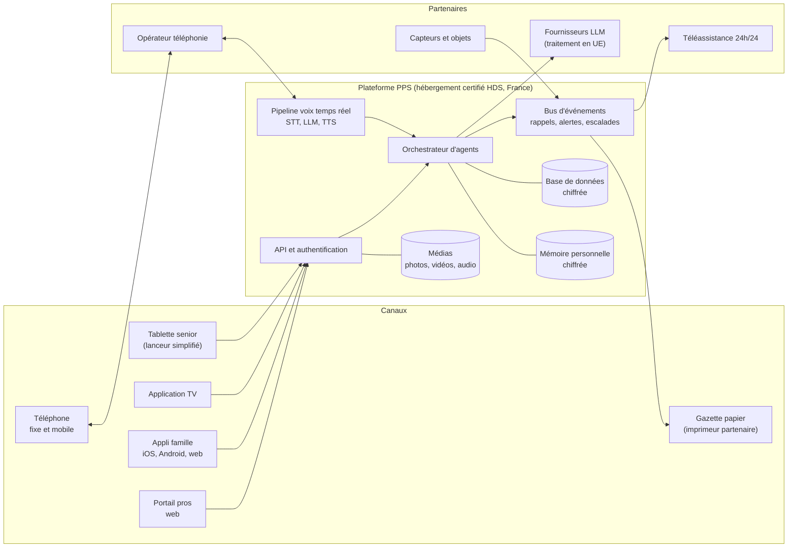

# 6. Architecture technique (première proposition)

Une proposition de départ pour cadrer les choix. Elle sera revue une fois le
MVP précisé et l'équipe constituée.

> Le principe des **deux étages** (un moteur de soin sans IA, infaillible,
> et des agents IA qui proposent sans jamais décider seuls) et le choix de
> l'orchestrateur sont détaillés dans le
> [document 8](08-faisabilite-et-choix-ia.md).

## Vue d'ensemble



## Choix proposés

| Couche | Proposition | Pourquoi |
|---|---|---|
| **Applis mobiles** (famille et tablette senior) | React Native (Expo) ou Flutter | Un seul code pour iOS et Android. Le lanceur senior est une variante très simplifiée de la même base. |
| **Web** (famille, portail pros, back-office) | Next.js (TypeScript) | Rapide à développer, bon référencement pour le site public. |
| **Back-end métier** | TypeScript (NestJS) ou Python (FastAPI) | Python facilite le travail sur l'IA ; TypeScript permet de partager le code avec le front. À trancher selon l'équipe. |
| **Base de données** | PostgreSQL | Fiable, éprouvée, chiffrement possible au niveau des colonnes sensibles. |
| **Tâches planifiées et alertes** | Moteur de workflows durables (Temporal) | Les rappels et escalades doivent être fiables à la minute près, avec reprise en cas de panne. |
| **Voix temps réel** | LiveKit Agents (ou Pipecat) : pipeline STT → LLM → TTS en streaming | Latence faible, gestion des interruptions et de la fin de parole, indispensables au téléphone. |
| **Téléphonie** | Opérateur SIP avec numéros français, raccordé au framework voix | Appels sortants planifiés, appels entrants, enregistrement consenti. |
| **Orchestrateur d'agents** | Code maison léger, outils exposés via MCP | Contrôle total des outils accessibles à chaque agent, pas d'auto-modification. |
| **Gestion des tablettes** | Android Management API (enrôlement sans contact, mode dédié), Apple Business Manager et MDM pour les iPad | Tablettes livrées prêtes à l'emploi et gérables à distance. |
| **Hébergement** | Hébergeur certifié HDS en France | Obligatoire dès qu'on héberge des données de santé. |
| **Observabilité** | Journaux, métriques, alertes techniques | Une alerte manquée peut avoir des conséquences graves : la supervision est critique. |

## Principes d'architecture

- **Fiabilité avant tout** : les rappels et les alertes passent par un
  système dédié, redondant, indépendant du reste. Si l'IA est indisponible,
  un rappel simple (SMS ou appel avec message enregistré) prend le relais.
- **Mode dégradé** : la tablette senior doit fonctionner hors connexion pour
  l'essentiel (rappels, photos déjà reçues, numéros d'urgence).
- **Sécurité par défaut** : chiffrement en transit et au repos, double
  authentification pour la famille et les pros, journal des accès consultable
  par le senior.
- **Minimisation des données** : on ne collecte que ce qui sert. Les
  enregistrements audio sont supprimés après transcription, sauf choix
  explicite (par exemple pour le livre de vie).
- **Multi-fournisseurs pour l'IA** : pouvoir changer de modèle sans tout
  réécrire, pour la souveraineté, le coût et la qualité.
- **Interopérabilité** : modèles de données inspirés de HL7 FHIR dès le départ,
  pour faciliter plus tard la connexion à Mon Espace Santé et aux logiciels
  des professionnels.

## Structure du dépôt envisagée

```text
pps/
├── apps/
│   ├── famille/        # appli mobile famille (iOS, Android)
│   ├── senior/         # lanceur tablette simplifié
│   ├── web/            # site public, espace famille web, portail pros
│   └── tv/             # application TV (V2)
├── services/
│   ├── api/            # API métier
│   ├── voix/           # pipeline voix et téléphonie
│   ├── agents/         # orchestrateur et agents IA
│   └── alertes/        # rappels, check-in, escalades
├── packages/           # code partagé (modèles, UI, client API)
└── docs/               # ce brainstorming et la documentation
```
