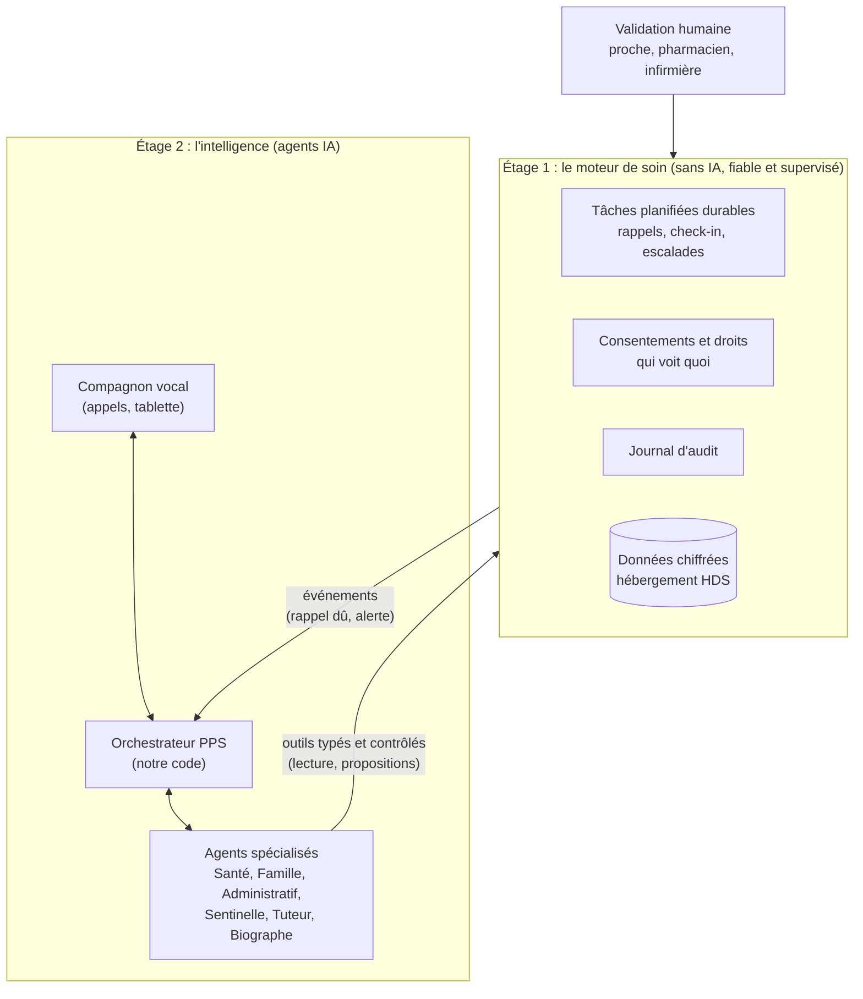

# 8. Faisabilité technique et choix de l'orchestrateur IA

## Est-ce faisable techniquement ? Oui, avec des briques qui existent déjà

En 2026, toutes les briques nécessaires existent et sont utilisées en
production ailleurs. La difficulté n'est pas d'inventer une technologie, mais
de **les assembler de façon fiable, simple et conforme** pour un public
vulnérable.

| Fonctionnalité | Maturité | Commentaire |
|---|---|---|
| Appel vocal IA sur fixe ou mobile, en français | **Mature** | Des frameworks open source gèrent la téléphonie, les interruptions et la détection de fin de parole. Des services d'appels IA aux seniors existent déjà (inTouch en France, Joy Calls et Meela aux États-Unis). |
| Compréhension des voix âgées | **À valider** | C'est le vrai risque technique : voix tremblantes, débit lent, accents, appareils dentaires, bruit de la télé. À mesurer dès la phase 0 sur de vraies voix. |
| Rappels, check-in, cascade d'alerte | **Mature** | C'est de l'ingénierie classique, sans IA. Il faut surtout la rendre très fiable. |
| Lecture d'ordonnance et de courrier par photo | **Mature** | Les modèles actuels lisent très bien les documents. La validation humaine reste obligatoire pour la santé. |
| Synthèses pour la famille (résumé du dimanche) | **Mature** | Tâche typique des grands modèles de langage. |
| Tablette verrouillée et préconfigurée | **Mature** | Les outils de gestion de flotte d'Android et d'Apple le permettent (voir le [document 9](09-preconfiguration-et-prise-en-main.md)). |
| Prise en main à distance de l'écran | **Mature** | Des SDK existent, mais il faut encadrer le consentement à chaque session. |
| Mesures de santé par objets connectés | **Mature** | Tensiomètres, balances, oxymètres et montres certifiés existent et exposent leurs données. Le cadre légal est le vrai sujet (voir le [document 10](10-suivi-sante-a-distance.md)). |
| Détection de signaux faibles (déclin cognitif, chute) | **Recherche ou certification** | Faisable techniquement, mais relève du dispositif médical : à faire avec un partenaire clinique. |

## Peut-on s'appuyer sur Hermes Agent ?

### Ce qu'est Hermes Agent

[Hermes Agent](https://github.com/NousResearch/hermes-agent) est un agent IA
open source (licence MIT) publié par Nous Research en 2026. Il est très
populaire et propose :

- une **mémoire persistante** entre les sessions ;
- des **« skills » que l'agent écrit lui-même** après des tâches complexes, et
  qu'il améliore au fil de l'usage ;
- une **passerelle de messagerie** : Telegram, WhatsApp, Signal, Slack,
  Discord, e-mail ;
- un **planificateur** de tâches récurrentes ;
- l'**accès à un terminal** (exécution de commandes) et à un navigateur ;
- le choix du modèle (OpenRouter, Nous Portal, OpenAI, points d'accès
  personnalisés…).

### Pourquoi ce n'est pas le bon cœur pour PPS

Hermes Agent est excellent pour ce pour quoi il a été conçu : **un assistant
personnel pour un utilisateur averti**. Mais plusieurs de ses choix de
conception vont à l'encontre de nos exigences.

| Exigence PPS | Hermes Agent | Conséquence |
|---|---|---|
| **Des milliers de familles sur une même plateforme**, isolées les unes des autres | Sa politique de sécurité indique qu'il est conçu pour **un seul opérateur de confiance**. L'isolation entre utilisateurs doit être faite au niveau du système ou de la machine. | Il faudrait une instance isolée par famille : lourd à exploiter, coûteux, difficile à superviser. |
| **Comportement prévisible et contrôlé** (rappels de médicaments, alertes) | Il **écrit et modifie ses propres skills** au fil de l'usage. | Incompatible avec la maîtrise des changements qu'exigent les données de santé, le règlement IA et, plus tard, le marquage dispositif médical. |
| **Aucune action dangereuse possible** | Il exécute des commandes sur un terminal, **directement sur la machine par défaut**. L'isolation en conteneur est optionnelle. | Une surface d'attaque inutile pour un service qui manipule des données de santé. |
| **Appels téléphoniques temps réel** | Pas de téléphonie. La voix se limite à la transcription de messages vocaux. | Il faudrait de toute façon une autre brique pour l'appel du matin. |
| **Hébergement certifié HDS, journal d'audit, consentements** | Non prévu pour ces usages. | Tout serait à construire autour. |

**En résumé** : construire PPS sur Hermes Agent reviendrait à passer plus de
temps à **brider** l'agent qu'à l'utiliser.

### Où Hermes Agent peut quand même servir

- **Maquette interne** : simuler en quelques jours un « compagnon » avec des
  **personas fictifs joués par l'équipe**, pour travailler le ton, les
  questions et le résumé quotidien. **Jamais avec de vraies familles** : même
  un check-in sans réponse est une donnée de santé, et Hermes Agent passe par
  des fournisseurs d'IA et des messageries non maîtrisés.
- **Outil interne de l'équipe** : veille, support, automatisations internes.
- **Source d'inspiration** : sa gestion de la mémoire et son format de skills
  (standard ouvert agentskills.io) sont de bonnes idées à reprendre, en
  version figée et validée.

## L'architecture recommandée : deux étages

L'idée clé : **séparer ce qui doit être fiable et prévisible de ce qui doit
être intelligent**.

### Étage 1 : le moteur de soin, sans IA

- **Rappels, check-in quotidien, cascades d'alerte, consentements** : tout cela
  est géré par du code classique, testé, déterministe.
- Basé sur une **file de tâches planifiées durable dans PostgreSQL** (voir la
  [décision 0005](decisions/0005-planification-durable.md)) : un rappel est
  enregistré dans la même transaction que la validation du planning, et il
  est repris automatiquement si un serveur redémarre.
- **Si l'IA tombe en panne**, l'étage 1 continue : appel avec message
  enregistré et réponse par les touches du téléphone, ou SMS.
- **Fiable ne veut pas dire infaillible** : un opérateur téléphonique en
  panne, un téléphone éteint ou un réseau coupé restent possibles. Le système
  est donc **redondant et supervisé** (alerte à l'équipe si une tâche est en
  retard), et PPS ne se présente jamais comme un service d'urgence.
- C'est cet étage qui détient **la vérité** : le planning des médicaments
  validé, les droits de chaque proche, l'historique.

### Étage 2 : les agents IA

- **Notre propre orchestrateur**, volontairement simple : il reçoit la
  demande, choisit l'agent spécialisé, lui donne accès **uniquement** aux
  outils dont il a besoin.
- **Les agents n'ont jamais d'accès libre** : pas de terminal, pas de
  navigateur ouvert. Ils appellent des **outils typés** exposés par l'étage 1
  (par exemple « lire le planning du jour », « proposer un rappel »), via
  le protocole standard MCP (Model Context Protocol).
- **Les agents proposent, l'étage 1 dispose** : un agent peut proposer un
  planning de médicaments à partir d'une ordonnance, mais il ne devient actif
  qu'après validation humaine.
- **Les prompts et les skills sont versionnés et testés** comme du code :
  pas d'auto-modification en production.

### Les briques open source et services recommandés

Le code de PPS est écrit en **Rust**, déployé avec **Docker**, sur une base **PostgreSQL**. Le détail des choix techniques est dans le [document 6](06-architecture-technique.md).

| Besoin | Option recommandée | Alternatives |
|---|---|---|
| **Voix temps réel et téléphonie** | Serveur LiveKit et sa passerelle SIP (open source), avec notre **agent vocal en Rust** construit sur le SDK Rust de LiveKit | Framework Python LiveKit Agents, uniquement pour un prototype jetable en phase 0 |
| **Opérateur téléphonique** | Opérateur SIP avec numéros français | — |
| **Tâches planifiées durables** | **File de tâches PostgreSQL** en Rust (`FOR UPDATE SKIP LOCKED`, bail, idempotence) derrière un trait | Temporal (SDK Rust stable depuis septembre 2026) ou Restate, si les besoins dépassent la file de tâches |
| **Orchestrateur d'agents** | **Code Rust maison**, léger, avec rmcp (SDK officiel Rust de MCP) pour les outils | — |
| **Modèle de langage** | Un modèle de premier plan accessible depuis une **région européenne** | Plusieurs fournisseurs, pour ne pas dépendre d'un seul |
| **Reconnaissance et synthèse vocales** | Services spécialisés, choisis après un **banc d'essai sur des voix de seniors** | — |

### Quel modèle d'IA, et où ?

Les données de santé imposent de maîtriser **où** les données sont traitées.
Depuis septembre 2026, l'hébergement des données de santé doit se faire
**exclusivement dans l'UE ou l'EEE** (voir le
[document 10](10-suivi-sante-a-distance.md)). Être dans une « région
européenne » ne suffit pas : **le service précis** (modèle d'IA,
reconnaissance vocale, synthèse vocale) doit figurer dans le périmètre d'un
certificat HDS, et le traitement doit rester dans l'EEE. À défaut, ce service
ne reçoit **aucune donnée de santé**. Ces conditions sont à faire valider par
le juriste avant le pilote.

- **Claude (Anthropic)** est disponible dans des régions européennes via
  Amazon Bedrock et Google Cloud Vertex AI. Ces deux clouds ont des régions en
  France certifiées HDS ; il faut vérifier que le service d'IA lui-même entre
  dans le périmètre du certificat, et la disponibilité des modèles par
  région.
- **Mistral AI** (français) est une alternative souveraine, utilisable en
  Europe et en partie auto-hébergeable.
- **Modèles open source auto-hébergés** (dont la famille Hermes de Nous
  Research, Llama, Mistral) : contrôle maximal des données, au prix d'une
  qualité de conversation à évaluer et d'un coût d'exploitation des
  serveurs GPU.

**Recommandation** : une architecture **multi-fournisseurs**. Un modèle de
premier plan en région européenne pour la conversation et les synthèses ;
un modèle plus petit, éventuellement auto-hébergé, pour les tâches simples
et volumineuses (classification, extraction). Dans les contrats, exiger
qu'**aucune donnée ne serve à l'entraînement** des modèles.

## Les vrais risques techniques, et comment les réduire

| Risque | Comment le réduire |
|---|---|
| L'IA comprend mal les voix âgées | Banc d'essai dès la phase 0 avec 30 à 50 voix réelles (avec consentement), comparaison de plusieurs moteurs, possibilité de répéter, de reformuler, et de confirmer les informations importantes. |
| Latence dans la conversation au téléphone | Pipeline en streaming, modèle rapide pour la conversation, phrases d'attente naturelles (« Je regarde… »). |
| Une alerte ne part pas | Étage 1 sans IA, redondance, supervision 24h/24, tests automatiques quotidiens de bout en bout. |
| L'IA invente une information médicale | L'agent Santé ne répond qu'à partir des données validées de l'étage 1, et redirige vers un professionnel pour tout le reste. |
| Coût de l'IA par senior | Durée d'appel maîtrisée, modèles adaptés à chaque tâche, cache des prompts, suivi du coût par famille dès le MVP. |
