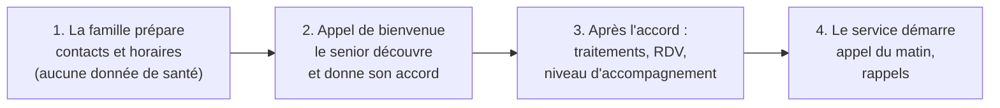

# 9. Préconfiguration et prise en main : simple dès la première minute

## L'objectif

> **10 minutes de mise en service pour la famille. Zéro pour le senior.**

Le senior ne crée pas de compte, ne choisit pas de mot de passe, ne télécharge
rien et ne règle rien. Tout est préparé à distance par un proche, ou par un
conseiller PPS. Le senior découvre un service qui **fonctionne déjà**, et
**rien ne touche à sa santé tant qu'il n'a pas donné son accord**.

> **Au MVP** (voir la [décision 0004](decisions/0004-perimetre-mvp.md)) : le
> senior utilise son **téléphone habituel**, la famille un **espace web**
> installable sur son téléphone. La tablette préconfigurée décrite plus bas
> arrive en V2.

## Le parcours de démarrage en 4 étapes

### Étape 1 : la famille prépare (5 minutes, aucune donnée de santé)

Un proche (l'« organisateur ») renseigne uniquement ce qui permet de
**contacter** le senior et de lui **présenter** le service. Il peut aussi le
faire par téléphone avec un conseiller PPS.

| Question | Exemple | Ce que ça configure |
|---|---|---|
| Comment s'appelle votre proche, et comment aime-t-il qu'on l'appelle ? | « Jeanne, elle préfère Madame Martin au début » | Le ton du compagnon, le vouvoiement |
| Quel téléphone utilise-t-il ? | Fixe, mobile, ou les deux | Le canal de l'appel |
| À quel moment l'appeler pour la première fois ? | Samedi à 10h, quand Sophie sera là | L'appel de bienvenue |
| Qui fait partie de son entourage ? | Sophie (fille), Marc (fils), Lucas (petit-fils), la voisine | Les invitations, qui ne donnent accès à **aucune** donnée tant que le senior n'a pas consenti |
| Qu'aime-t-il ? | Le rugby, son jardin, les mots croisés | Les sujets de conversation du compagnon |

**Rien d'autre n'est collecté à ce stade** : ni traitement, ni rendez-vous
médical, ni niveau d'autonomie.

### Étape 2 : l'appel de bienvenue, et l'accord du senior

C'est un moment clé, à soigner particulièrement.

1. Le compagnon appelle à l'heure convenue, de préférence **en présence
   d'un proche** (sur place ou au téléphone).
2. Il se présente clairement : « Je suis Léon, un assistant, une intelligence
   artificielle. Votre fille Sophie a pensé que je pourrais vous être utile. »
3. Il explique en mots simples ce qu'il fera, et ce qu'il ne fera jamais.
4. Il propose de choisir sa voix, son prénom et l'heure de l'appel du matin.
5. Il demande l'**accord du senior** pour chaque partage important : « Vous
   êtes d'accord pour que Sophie sache si vous avez pris vos médicaments ? »
6. L'accord est enregistré et **le senior peut changer d'avis à tout moment**,
   simplement en le disant.
7. Lors d'un appel suivant, **seul à seul**, le compagnon repose les
   questions de partage : le consentement doit venir du senior, sans
   pression de la famille, même bien intentionnée.

Un accord n'est recueilli que lors d'un appel **émis par PPS** vers un numéro
vérifié (le numéro d'un appelant peut être usurpé). Un **retrait** d'accord,
lui, est accepté par n'importe quel canal.

**Si le senior refuse, rien n'est activé et les informations le concernant
sont supprimées.** Il est informé de ce qui avait été préparé et de cette
suppression. On ne force jamais.

Au MVP, PPS s'adresse aux seniors **capables de consentir seuls**. Les
situations où un représentant légal décide (voir le
[document 10](10-suivi-sante-a-distance.md)) viendront plus tard.

### Étape 3 : après l'accord, les informations de santé

Une fois l'accord donné, et dans les limites de ce que le senior a accepté :

| Information | Qui la saisit | Ce que ça configure |
|---|---|---|
| Traitements | Le proche organisateur, avec l'accord du senior (saisie manuelle au MVP, photo de l'ordonnance en V2) | Une **proposition** de planning, qui ne déclenche aucun rappel avant validation par un humain habilité |
| Prochains rendez-vous | Le senior (au téléphone) ou un proche autorisé | L'agenda partagé |
| Qui prévenir en cas d'inquiétude, et dans quel ordre | Le senior, avec ses proches | La cascade d'alerte, limitée aux proches qu'il a autorisés |
| Niveau d'accompagnement | Le senior et l'organisateur, ensemble | Le **profil de réglages par défaut** (voir plus bas) |

### Étape 4 : le service démarre

- **Appel du matin** dès le lendemain, à l'heure choisie.
- **Rappels** activés une fois le planning des médicaments validé.
- **Espace famille** : chaque proche invité se connecte et voit uniquement ce
  que le senior a accepté de partager avec lui.

## Quatre façons d'équiper le senior

| Mode | Pour qui | Mise en service | Quand |
|---|---|---|---|
| **Téléphone seul** | Tous, et ceux qui ne veulent pas d'écran | **Rien à installer.** L'appel du matin arrive sur le fixe ou le mobile. | **MVP** |
| **Tablette PPS** | Ceux qui veulent voir les photos et faire des visios | Tablette **4G avec forfait inclus** : elle fonctionne dès qu'on l'allume, même sans box internet. **Préconfigurée avant l'envoi** et verrouillée sur l'interface PPS. | V2 |
| **Son propre appareil Android** | Ceux qui ont déjà une tablette ou un smartphone | Le proche installe l'appli PPS, puis **scanne un QR code** affiché dans son espace famille. | V2 |
| **Son propre iPhone ou iPad** | Utilisateurs Apple | Installation de l'appli PPS, avec un tutoriel guidé pour activer l'**Accès assisté** d'Apple (une interface simplifiée prévue pour les personnes avec troubles cognitifs, disponible depuis iOS 17). | V2 |

### Comment la tablette arrivera prête à l'emploi (V2)

C'est techniquement maîtrisé grâce aux outils de gestion de flotte des
fabricants :

- **Android** : l'**enrôlement sans contact** (*zero-touch enrollment*) permet
  de préenregistrer les tablettes achetées auprès d'un revendeur agréé. Au
  premier allumage, la tablette se configure **toute seule**. Le **mode
  appareil dédié** (*lock task mode*) la verrouille sur l'interface PPS : pas
  de menus, pas de magasin d'applications, pas de notifications parasites.
- **Apple** : les iPad achetés via Apple Business Manager peuvent être
  **supervisés** et gérés à distance, avec un **mode application unique** qui
  garde l'interface PPS au premier plan, même après un redémarrage.
- **À distance**, avec l'accord du senior : PPS ou un proche peut ajuster la
  taille du texte, le volume, les contacts, et installer les mises à jour la
  nuit, sans que le senior ait quoi que ce soit à faire.
- **Pas de biométrie** (visage, voix) pour identifier le senior : ce sont des
  données sensibles, et la voix peut être clonée. On s'appuie sur
  l'appairage de l'appareil et sur le verrouillage natif du système.

### Le kit de démarrage (V2)

Dans le carton :

- la tablette, déjà allumée sur l'écran d'accueil avec les photos de la
  famille ;
- un **socle de charge** : on pose la tablette, elle se recharge, sans câble
  à brancher dans un petit port ;
- un **guide papier en gros caractères**, avec des photos, d'une seule page ;
- une carte : « **PPS ne vous demandera jamais d'argent, ni de code
  bancaire.** »

La **fiche urgence** (QR code sur le frigo) est une fonctionnalité à part,
plus tard : contenu minimal choisi par le senior, consentie, révocable, et
chaque consultation est journalisée.

**Option** : installation à domicile par un conseiller, ou en visio avec la
famille.

## Des préconfigurations selon le niveau d'accompagnement

Le profil choisi à l'étape 3 applique un **paquet de réglages par défaut**.
Le senior et sa famille peuvent ensuite tout ajuster. Au MVP, seuls les
niveaux 2 et 3 sont proposés.

| Réglage | Niveau 1 : Connecté | Niveau 2 : Accompagné | Niveau 3 : Soutenu | Niveau 4 : Entouré |
|---|---|---|---|---|
| Interface tablette (V2) | Complète, avec l'Académie | 6 grandes tuiles | 4 grandes tuiles | 2 boutons : parler, appeler à l'aide |
| Appel du matin | Optionnel | Oui | Oui, et un appel en fin de journée | Oui, avec des appels de réassurance |
| Rappels médicaments | Notification | Voix et appel | Appel, puis alerte au proche | Appel, puis alerte, avec un aidant référent |
| Check-in et cascade d'alerte | Non | Oui | Oui | Oui, avec des délais plus courts |
| Décroché automatique de la visio (V2) | Non | Non | Optionnel | Optionnel |
| Bouclier anti-arnaque | Oui | Oui | Oui | Oui, renforcé |
| Mode souvenirs (« C'est Léa, votre petite-fille ») | Non | Non | Optionnel | Oui |

Le **décroché automatique de la visio** suppose le consentement du senior (ou
de son représentant légal), un voyant bien visible pendant l'appel, une liste
fermée de contacts autorisés, et la validation du comité éthique.

## Simple aussi pour la famille

- **Aucun mot de passe** : connexion par **lien magique envoyé par e-mail**
  au début, puis par **clé d'accès** (passkey) sur le téléphone avant le
  pilote. Une **authentification récente** est exigée pour les actions
  sensibles (valider un planning, modifier les droits). Le SMS sert aux
  invitations, pas à la connexion (voir la
  [décision 0006](decisions/0006-authentification.md)).
- **Invitation en un clic** par SMS ou WhatsApp, avec un **rôle prédéfini**
  (organisateur, proche, petit-enfant, voisin) et **aucun accès aux données
  de santé** tant que le senior n'a pas consenti pour ce proche.
- **Trois onglets, pas plus** : *Nouvelles* (photos, messages), *Agenda*
  (rendez-vous, qui fait quoi), *Comment va-t-il ?* (le résumé, les alertes).
- **Les notifications ne contiennent jamais de donnée de santé** : un SMS ou
  un e-mail dit seulement « Du nouveau vous attend dans votre espace PPS »,
  avec un lien vers l'espace sécurisé. La formulation, volontairement
  neutre (elle ne révèle même pas s'il s'agit d'une alerte), sera validée
  dans l'analyse d'impact. Le contenu reste dans l'espace authentifié, hébergé en HDS.
- **Un numéro d'assistance** pour la famille aussi, parce que tous les
  enfants ne sont pas à l'aise avec le numérique.

## Comment on vérifiera que c'est vraiment simple

- **Le test de l'aidant pressé** : un aidant doit terminer la préparation en
  moins de 10 minutes, depuis son téléphone.
- **Le test de la grand-mère** (V2, tablette) : 5 seniors, sans aide, doivent
  réussir à appeler un proche depuis la tablette en moins d'une minute.
- **Indicateurs suivis** : temps de mise en service, taux d'accord à l'appel
  de bienvenue, nombre d'appels au support dans le premier mois, taux
  d'abandon pendant la préparation.
