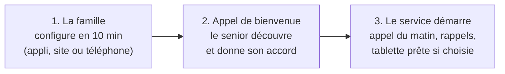

# 9. Préconfiguration et prise en main : simple dès la première minute

## L'objectif

> **10 minutes de mise en service pour la famille. Zéro pour le senior.**

Le senior ne crée pas de compte, ne choisit pas de mot de passe, ne télécharge
rien et ne règle rien. Tout est préparé à distance par un proche, ou par un
conseiller PPS. Le senior découvre un service qui **fonctionne déjà**.

## Le parcours de démarrage en 3 étapes

### Étape 1 : la famille configure (10 minutes)

Un proche (l'« organisateur ») répond à un **questionnaire conversationnel**,
à l'écrit ou à la voix avec l'assistant. Il peut aussi être fait par
téléphone avec un conseiller PPS.

| Question | Exemple | Ce que ça configure |
|---|---|---|
| Comment s'appelle votre proche, et comment aime-t-il qu'on l'appelle ? | « Jeanne, elle préfère Madame Martin au début » | Le ton du compagnon, le vouvoiement |
| Quel téléphone utilise-t-il ? | Fixe, mobile, ou les deux | Le canal de l'appel du matin |
| Souhaitez-vous une tablette ? | Non / tablette PPS / sa propre tablette | L'envoi ou non d'un appareil préconfiguré |
| À quelle heure l'appeler ? | 9h30, après sa toilette | Le planning de l'appel quotidien |
| Qui fait partie de son entourage ? | Sophie (fille), Marc (fils), Lucas (petit-fils), la voisine | Les invitations par SMS, les rôles |
| Quels sont ses traitements ? | Photo de l'ordonnance | Une **proposition** de planning, validée par un humain avant activation |
| Quels sont ses prochains rendez-vous ? | Cardiologue le 12 | L'agenda partagé |
| Qu'aime-t-il ? | Le rugby, son jardin, les mots croisés | Les sujets de conversation du compagnon |
| Qui prévenir en cas d'inquiétude, et dans quel ordre ? | Voisine, puis Sophie, puis Marc | La cascade d'alerte |
| Quel est son niveau d'autonomie ? | Il vit seul, se déplace bien, oublie parfois ses médicaments | Le **profil de réglages par défaut** (voir plus bas) |

Tout reste **modifiable plus tard**, et rien n'est définitif tant que le senior
n'a pas donné son accord.

### Étape 2 : l'appel de bienvenue, et l'accord du senior

C'est un moment clé, à soigner particulièrement.

1. Le compagnon appelle à une heure convenue, de préférence **en présence
   d'un proche** (sur place ou au téléphone).
2. Il se présente clairement : « Je suis Léon, un assistant, une intelligence
   artificielle. Votre fille Sophie a pensé que je pourrais vous être utile. »
3. Il explique en mots simples ce qu'il fera, et ce qu'il ne fera jamais.
4. Il propose de choisir sa voix, son prénom et l'heure de l'appel.
5. Il demande l'**accord du senior** pour chaque partage important : « Vous
   êtes d'accord pour que Sophie sache si vous avez pris vos médicaments ? »
6. L'accord est enregistré et **le senior peut changer d'avis à tout moment**,
   simplement en le disant.
7. Lors d'un appel suivant, **seul à seul**, le compagnon repose les
   questions de partage : le consentement doit venir du senior, sans
   pression de la famille, même bien intentionnée.

**Si le senior refuse, rien n'est activé.** On ne force jamais. Pour une
personne qui n'est plus en mesure de consentir, c'est son représentant légal
qui décide (voir le [document 10](10-suivi-sante-a-distance.md)).

### Étape 3 : le service démarre

- **Appel du matin** dès le lendemain, à l'heure choisie.
- **Rappels** activés une fois le planning des médicaments validé.
- **Appli famille** : chaque proche invité reçoit un SMS avec un lien, et
  arrive directement dans le cercle.
- **Tablette** livrée prête à l'emploi, si elle a été choisie.

## Quatre façons d'équiper le senior

| Mode | Pour qui | Mise en service |
|---|---|---|
| **Téléphone seul** | Ceux qui ne veulent pas d'écran | **Rien à installer.** L'appel du matin arrive sur le fixe ou le mobile. Le senior peut aussi appeler un numéro unique pour parler à son compagnon. |
| **Tablette PPS** (recommandée pour les niveaux 2 à 4) | Ceux qui veulent voir les photos et faire des visios | Tablette **4G avec forfait inclus** : elle fonctionne dès qu'on l'allume, même sans box internet. Elle est **préconfigurée avant l'envoi** et verrouillée sur l'interface PPS. |
| **Son propre appareil Android** | Ceux qui ont déjà une tablette ou un smartphone | Le proche installe l'appli PPS, puis **scanne un QR code** affiché dans son appli famille. La configuration se charge toute seule. |
| **Son propre iPhone ou iPad** | Utilisateurs Apple | Installation de l'appli PPS, avec un tutoriel guidé pour activer l'**Accès assisté** d'Apple (une interface simplifiée prévue pour les personnes avec troubles cognitifs, disponible depuis iOS 17). |

### Comment la tablette arrive prête à l'emploi

C'est techniquement maîtrisé grâce aux outils de gestion de flotte des
fabricants :

- **Android** : l'**enrôlement sans contact** (*zero-touch enrollment*) permet
  de préenregistrer les tablettes achetées auprès d'un revendeur agréé. Au
  premier allumage, la tablette se configure **toute seule**. Le **mode
  appareil dédié** (*lock task mode*) la verrouille sur l'interface PPS : pas
  de menus, pas de magasin d'applications, pas de notifications parasites.
- **Apple** : les iPad achetés via Apple Business Manager peuvent être
  **supervisés** et gérés à distance, avec un **mode application unique** qui
  garde l'interface PPS au premier plan, même après un redémarrage.
- **À distance**, avec l'accord du senior : PPS ou un proche peut ajuster la
  taille du texte, le volume, les contacts, et installer les mises à jour la
  nuit, sans que le senior ait quoi que ce soit à faire.

### Le kit de démarrage

Dans le carton :

- la tablette, déjà allumée sur l'écran d'accueil avec les photos de la
  famille ;
- un **socle de charge** : on pose la tablette, elle se recharge, sans câble
  à brancher dans un petit port ;
- un **guide papier en gros caractères**, avec des photos, d'une seule page ;
- un **autocollant « fiche urgence »** avec QR code, à coller sur le frigo ;
- une carte : « **PPS ne vous demandera jamais d'argent, ni de code
  bancaire.** »

**Option** : installation à domicile par un conseiller, ou en visio avec la
famille.

## Des préconfigurations selon le niveau d'accompagnement

Le profil choisi à l'étape 1 applique un **paquet de réglages par défaut**.
La famille et le senior peuvent ensuite tout ajuster.

| Réglage | Niveau 1 : Connecté | Niveau 2 : Accompagné | Niveau 3 : Soutenu | Niveau 4 : Entouré |
|---|---|---|---|---|
| Interface tablette | Complète, avec l'Académie | 6 grandes tuiles | 4 grandes tuiles | 2 boutons : parler, appeler à l'aide |
| Appel du matin | Optionnel | Oui | Oui, et un appel en fin de journée | Oui, avec des appels de réassurance |
| Rappels médicaments | Notification | Voix et appel | Appel, puis alerte au proche | Appel, puis alerte, avec un aidant référent |
| Check-in et cascade d'alerte | Non | Oui | Oui | Oui, avec des délais plus courts |
| Décroché automatique de la visio | Non | Non | Optionnel | Optionnel |
| Bouclier anti-arnaque | Oui | Oui | Oui | Oui, renforcé |
| Mode souvenirs (« C'est Léa, votre petite-fille ») | Non | Non | Optionnel | Oui |

## Simple aussi pour la famille

- **Aucun mot de passe** : connexion par lien envoyé par SMS ou par clé
  d'accès (passkey) sur le téléphone.
- **Invitation en un clic** par SMS ou WhatsApp, avec un **rôle prédéfini**
  (organisateur, proche, petit-enfant, voisin, professionnel) et des droits
  par défaut que le senior peut ajuster.
- **Trois onglets, pas plus** : *Nouvelles* (photos, messages), *Agenda*
  (rendez-vous, qui fait quoi), *Comment va-t-il ?* (le résumé, les alertes).
- **Pas obligé d'installer l'appli** : un petit-enfant peut recevoir le résumé
  par SMS ou par e-mail, et répondre directement par message.
- **Un numéro d'assistance** pour la famille aussi, parce que tous les
  enfants ne sont pas à l'aise avec le numérique.

## Comment on vérifiera que c'est vraiment simple

- **Le test de la grand-mère** : 5 seniors, sans aide, doivent réussir à
  appeler un proche depuis la tablette en moins d'une minute.
- **Le test de l'aidant pressé** : un aidant doit terminer la mise en service
  en moins de 15 minutes, depuis son téléphone.
- **Indicateurs suivis** : temps de mise en service, nombre d'appels au
  support dans le premier mois, taux d'abandon pendant la configuration.
