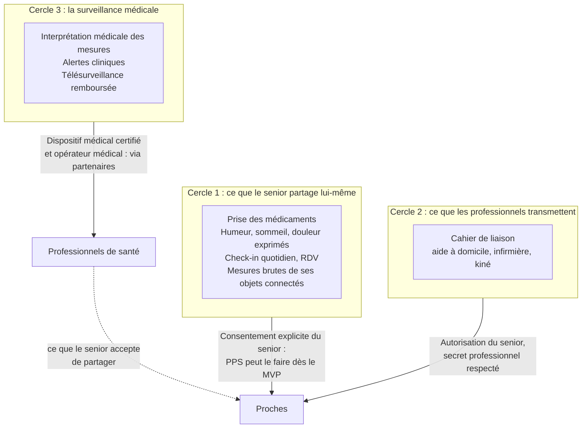

# 10. Suivi de santé à distance par les proches : ce qui est possible légalement

> Ce document est un premier repérage juridique, établi en octobre 2026 à
> partir de recherches web (extraits de sources officielles et de cabinets
> spécialisés). **Il doit être validé par un avocat en droit de la santé et
> du numérique avant tout lancement.** Les références sont listées en fin de
> document.

## La réponse courte

**Oui, les proches peuvent suivre l'état de santé du senior à distance**, à
une condition centrale : **c'est le senior qui décide**, explicitement, de ce
qu'il partage et avec qui, et il peut changer d'avis à tout moment. Ce qui
change selon les cas, c'est **qui produit l'information** et **qui
l'interprète**.

On distingue trois cercles, du plus simple au plus encadré.

## Cercle 1 : ce que le senior partage lui-même

**C'est le cœur de PPS, et c'est faisable dès le MVP.**

Le secret médical lie les professionnels, **pas le patient** : le senior est
libre de partager ses propres données de santé avec qui il veut. Pour PPS, la
base légale est son **consentement explicite** (RGPD, article 9.2.a).

### Ce que les proches peuvent voir, si le senior l'accepte

- la **prise des médicaments** (confirmée ou non) ;
- les **rendez-vous** médicaux et leurs comptes rendus dictés par le senior ;
- l'**humeur, le sommeil, l'appétit, la douleur**, tels que le senior les a
  **exprimés** dans la conversation (« Elle dit avoir mal dormi deux nuits de
  suite ») ;
- le **check-in quotidien** (« ça va » ce matin, ou pas de réponse) ;
- les **mesures brutes de ses objets connectés certifiés** (tension, poids,
  oxygénation, glycémie), affichées telles quelles ;
- une **alerte de chute** de type téléassistance.

### Ce sont toutes des données de santé

La CNIL distingue les données de santé **par nature** (un traitement, une
douleur), **par croisement** et **par destination** (une donnée utilisée dans
un but de santé). L'observance médicamenteuse est une donnée de santé par
nature. Même « pas de réponse au check-in ce matin » en devient une dans un
service de veille comme PPS.

**Conséquences :**

- **hébergement certifié HDS**, et désormais **exclusivement dans l'Union
  européenne ou l'Espace économique européen** (voir plus bas) ;
- **analyse d'impact (AIPD) obligatoire** : données sensibles, personnes
  vulnérables, suivi systématique et IA se cumulent ;
- **délégué à la protection des données** et registre des traitements.

### Un consentement vraiment libre

Le consentement doit être **explicite, granulaire, révocable et libre**.
Comme c'est souvent la famille qui souscrit et qui paie, il faut s'assurer
que l'accord vient bien du senior, **sans pression familiale**.

- Accord **catégorie par catégorie et proche par proche** (« Sophie voit les
  médicaments, Lucas voit seulement les photos »).
- Un proche peut être présent lors de l'appel de bienvenue pour rassurer,
  mais les questions de partage sont **reposées seul à seul** au senior lors
  d'un appel suivant.
- **Révocation d'une simple phrase** : « Je ne veux plus que Marc voie mes
  médicaments. »
- **Transparence permanente** : « qui voit quoi ? » obtient toujours une
  réponse claire, lue à voix haute si besoin. Journal des accès consultable.
- **Revue des consentements** tous les 6 mois, ou quand la situation change.

### Le point de vigilance : interpréter, c'est soigner

**Afficher** une tension artérielle telle quelle, c'est du partage
d'information : ce n'est pas un dispositif médical. Un logiciel qui se limite
à stocker, transmettre ou afficher des données sans les interpréter reste en
dehors du règlement européen sur les dispositifs médicaux.

En revanche, **« tension au-dessus de 16, prévenez votre fille »**, c'est une
surveillance de paramètres physiologiques. Le logiciel devient alors très
probablement un **dispositif médical** (classe IIa ou plus), avec marquage
CE, organisme notifié et, à partir d'août 2028, les obligations des IA « à
haut risque ».

Pour le MVP, on s'en tient donc à des alertes **non médicales** :

- pas de réponse au check-in ;
- médicament non confirmé ;
- rendez-vous manqué ;
- chute signalée par un détecteur de téléassistance (une alarme sociale,
  sans prétention de diagnostic).

Un **rappel de médicament simple**, sans calcul ni ajustement de dose, n'est
en général pas un dispositif médical. Les alertes cliniques passent par le
cercle 3.

### Pas d'émotions déduites de la voix

L'IA peut noter que le senior **dit** être triste ou fatigué. En revanche,
**déduire ses émotions du ton de sa voix** (une donnée biométrique) ferait de
PPS un système de reconnaissance des émotions, classé **à haut risque** par
le règlement européen sur l'IA. On s'en tient donc au **contenu** de ce qui
est dit, jamais à l'analyse de la voix, sauf futur projet certifié.

## Cercle 2 : ce que les professionnels transmettent

L'aide à domicile, l'infirmière libérale ou le kiné notent leurs observations
dans le **cahier de liaison numérique**. C'est précieux pour la famille, mais
ces professionnels sont tenus au **secret professionnel**.

### Les règles

- Le secret (Code de la santé publique, article L.1110-4) s'impose aux
  professionnels **de santé** et aux professionnels **sociaux et
  médico-sociaux**, comme les aides à domicile, **y compris à l'égard des
  proches**.
- Entre membres d'une même **équipe de soins** (article L.1110-12), les
  professionnels peuvent partager ce qui est strictement nécessaire à la
  coordination des soins. Le senior doit en être informé et peut s'y opposer.
- **La famille ne fait jamais partie de l'équipe de soins.** Un professionnel
  ne peut donc transmettre une information aux proches **qu'avec l'accord
  du senior**.
- **Exception** : en cas de diagnostic ou de pronostic grave, la famille, les
  proches ou la personne de confiance peuvent recevoir les informations
  nécessaires pour soutenir le patient, sauf s'il s'y oppose.

### Comment PPS l'organise : deux espaces

| Espace | Qui écrit | Qui lit |
|---|---|---|
| **Espace soignants** | Professionnels autorisés | Uniquement les professionnels de l'équipe de soins du senior |
| **Espace famille** | Professionnels, proches, senior | Les proches autorisés par le senior, pour les catégories qu'il a choisies |

- Chaque professionnel voit clairement **qui lira sa note** avant de la
  publier, et reste responsable de ce qu'il écrit.
- Par défaut, une note de professionnel va dans l'**espace soignants**. La
  copier dans l'espace famille suppose l'autorisation du senior pour cette
  catégorie.
- Accès professionnels avec double authentification et journal d'audit.

## Cercle 3 : la surveillance médicale à distance

Quand il s'agit d'**interpréter** des données pour détecter une aggravation
(insuffisance cardiaque, diabète, hypertension…), on entre dans la
**télésurveillance médicale**.

### Le cadre français

Elle est entrée dans le droit commun et est remboursée depuis le
**1er juillet 2023** (Code de la sécurité sociale, articles L.162-48 et
suivants). Elle exige :

- un **dispositif médical numérique certifié CE**, inscrit sur la liste des
  produits pris en charge après avis de la HAS, ou bénéficiant de la prise en
  charge anticipée (PECAN) ;
- un **opérateur de télésurveillance** : un professionnel médical, ou une
  structure qui en emploie au moins un, déclaré à l'ARS ;
- une **prescription** médicale.

Le financement repose sur deux forfaits : un pour l'opérateur médical, un
pour l'exploitant du dispositif.

### Ce que PPS peut faire

**PPS n'est pas une société médicale : elle ne peut pas être opérateur de
télésurveillance.** En revanche, elle peut :

- **s'associer à des plateformes de télésurveillance certifiées**, quand le
  médecin du senior en prescrit une ;
- **faciliter le quotidien autour** : rappel des mesures, aide à la prise en
  main de l'appareil, relais des messages du soignant, logistique ;
- **montrer aux proches** ce que le senior accepte de partager du suivi
  médical (« l'infirmière a été prévenue et rappelle demain »).

À plus long terme (V3), PPS pourra développer ses propres fonctions médicales
(détection de chute avec analyse, repérage du déclin cognitif) **avec un
partenaire clinique et un marquage CE**.

## Quand le senior ne peut plus consentir seul

C'est fréquent avec les troubles cognitifs. La vigilance doit être maximale.

**Principe** (Code civil, article 459) : la personne protégée prend seule les
décisions qui concernent sa personne, **autant que son état le permet**.

| Situation | Qui consent au partage | Ce que PPS prévoit |
|---|---|---|
| **Senior capable de consentir** | Le senior, seul | Accord recueilli à l'appel de bienvenue, puis seul à seul, révocable à tout moment |
| **Curatelle** (mesure d'assistance) | Le senior lui-même | Le curateur peut être informé et l'assister |
| **Troubles cognitifs sans mesure de protection** | Le senior, tant qu'il est en mesure de comprendre. **Aucun proche ne peut consentir à sa place**, pas même la personne de confiance. | Explications simplifiées et répétées, consentements revus plus souvent. **Encourager tôt un mandat de protection future.** |
| **Tutelle, habilitation familiale ou mandat de protection future** couvrant la protection de la personne | Le senior s'il peut exprimer sa volonté ; sinon, la personne chargée de le représenter, **en tenant compte de son avis** | Rôle « représentant légal » avec justificatif ; le senior reste informé et associé |

**La personne de confiance** (article L.1111-6) accompagne le senior, assiste
aux entretiens médicaux et est consultée s'il ne peut plus s'exprimer. Mais
elle n'a pas de droit d'accès autonome à ses données, et ne peut pas
consentir à sa place au partage dans PPS.

Dans tous les cas :

- on cherche **toujours à associer le senior**, même quand un tiers décide ;
- on évite les fonctionnalités les plus intrusives (géolocalisation
  permanente, capteurs) sauf nécessité réelle et décision explicite ;
- le **comité éthique** valide les règles applicables à ces situations.

## Les opportunités qui arrivent

### Mon Espace Santé : la délégation à un proche

La **loi du 26 mai 2026** sur les soins palliatifs permet désormais au
titulaire de Mon Espace Santé d'**autoriser sa personne de confiance, un
parent ou un proche à accéder à son espace**, avec ses propres identifiants.

- Le proche peut consulter et déposer des documents.
- Il ne peut ni modifier ni supprimer, et n'a pas accès aux directives
  anticipées.
- L'autorisation est révocable.
- Les modalités dépendent d'un décret, dont la publication reste à vérifier.

Par ailleurs, Mon Espace Santé dispose d'un **catalogue de services**
référencés (plus de 150 critères de sécurité, d'interopérabilité et
d'éthique). Depuis septembre 2025, certaines applications référencées peuvent
**alimenter** le profil de l'usager.

**Pour PPS** : viser le référencement au catalogue, puis aider le senior à
déléguer l'accès à un proche dans le cadre officiel.

### L'Espace européen des données de santé (EHDS)

Le règlement européen 2025/327 s'appliquera progressivement à partir de
**mars 2027**, avec des étapes en 2029 et 2031.

- **Services de procuration** (article 4) : chaque État devra permettre à une
  personne d'autoriser gratuitement des proches à accéder à ses données de
  santé électroniques.
- **Applications de bien-être** (articles 47 à 49) : un label obligatoire
  pour celles qui se déclarent interopérables avec les dossiers de santé.

### Le nouveau cadre de l'hébergement

Un **décret du 24 mars 2026**, en vigueur depuis le **26 septembre 2026**,
impose aux hébergeurs de données de santé :

- un hébergement **exclusivement dans l'UE ou l'EEE** ;
- un accès depuis un pays tiers seulement avec une décision d'adéquation,
  ou un contrat détaillant les lois étrangères applicables, les mesures
  d'atténuation et les risques résiduels ;
- une cartographie publique des transferts.

Les régions européennes des grands clouds américains certifiés HDS restent
utilisables, sous ces conditions de transparence.

## En résumé : ce que PPS peut proposer aux familles

| Fonctionnalité | Légalement possible ? | Conditions |
|---|---|---|
| Voir si maman a pris ses médicaments | **Oui** | Consentement explicite du senior, hébergement HDS dans l'UE, AIPD |
| Savoir si elle a répondu à l'appel du matin | **Oui** | Consentement du senior |
| Lire son humeur, son sommeil, sa douleur tels qu'elle les décrit | **Oui** | Consentement, catégorie par catégorie, d'après ce qu'elle **dit** |
| Analyser son humeur à partir du ton de sa voix | **Non, pas sans certification** | IA à haut risque (reconnaissance des émotions) |
| Voir ses mesures de tension ou de poids | **Oui, affichées telles quelles** | Consentement, objets certifiés, pas d'interprétation automatique |
| Être alerté si la tension dépasse un seuil | **Pas en propre** | Dispositif médical : via un partenaire de télésurveillance certifié et un opérateur médical |
| Lire les notes de l'aide à domicile ou de l'infirmière | **Oui, dans l'espace famille** | Autorisation du senior, notes réservées aux soignants possibles |
| Être prévenu d'une chute | **Oui** | Détecteur de téléassistance (alarme sociale), consentement |
| Accéder à son Mon Espace Santé | **Bientôt** | Délégation prévue par la loi de mai 2026, décret attendu |
| Décider à sa place quand elle n'est plus en mesure de le faire | **Seulement avec une mesure de protection** | Tutelle, habilitation familiale ou mandat de protection future |
| Tout suivre sans que le senior le sache | **Non, jamais** | Contraire au RGPD et à notre charte |

## Sources

Relevées en octobre 2026 à partir de résultats de recherche web. Les pages
n'ont pas pu être consultées en intégralité : **à vérifier dans les textes
officiels.**

1. Secret médical et partage d'informations (AP-HP, 2024) :
   https://affairesjuridiques.aphp.fr/textes/le-secret-medical/
2. Partage d'informations entre professionnels autour de la personne âgée :
   https://guidejuridique.sante-complexe-occitanie.fr/3-le-devoir-de-secret-et-les-derogations/31-lechange-et-le-partage-dinformations-relatives-a-la-personne-agee-ou-en-situation-de-handicap-entre-professionnels-concourant-a-son-accompagnement
3. Consentement des majeurs protégés (AP-HP) :
   https://affairesjuridiques.aphp.fr/textes/le-consentement-des-majeurs-proteges-aux-actes-medicaux-2/
4. Télésurveillance médicale (Ameli) :
   https://www.ameli.fr/medecin/exercice-liberal/telemedecine/telesurveillance
5. Code de la sécurité sociale, section télésurveillance (Légifrance) :
   https://www.legifrance.gouv.fr/codes/id/LEGISCTA000044565906
6. Loi n° 2026-404 du 26 mai 2026 (Légifrance) :
   https://www.legifrance.gouv.fr/eli/loi/2026/5/26/2026-404/jo/texte
7. Alimentation de Mon Espace Santé par le catalogue de services (Assurance
   maladie, septembre 2025) :
   https://www.assurance-maladie.ameli.fr/presse/2025-09-25-cp-alimentation-mes-catalogue-services
8. Règlement (UE) 2025/327 sur l'Espace européen des données de santé :
   https://www.sanidad.gob.es/areas/saludDigital/espacioEuropeoDS/docs/OJ_L_202500327_EN_TXT.pdf
9. Guide MDCG 2019-11 sur la qualification des logiciels (Commission
   européenne) :
   https://health.ec.europa.eu/document/download/b45335c5-1679-4c71-a91c-fc7a4d37f12b_en?filename=mdcg_2019_11_en.pdf
10. CNIL, qu'est-ce qu'une donnée de santé :
    https://www.cnil.fr/fr/quest-ce-ce-quune-donnee-de-sante
11. CNIL, liste des traitements soumis à AIPD :
    https://www.cnil.fr/sites/cnil/files/atoms/files/liste-traitements-aipd-requise.pdf
12. Décret hébergeurs de données de santé et lieu d'hébergement (Delsol
    Avocats) :
    https://delsolavocats.com/fr/actualite/le-nouveau-decret-hebergeurs-saligne-sur-le-referentiel-de-certification-sagissant-du-lieu-dhebergement/
13. Report des échéances de l'AI Act par le « Digital Omnibus » (Cooley) :
    https://cdp.cooley.com/digital-ai-omnibus-delays-key-deadlines-introduces-new-rules/
